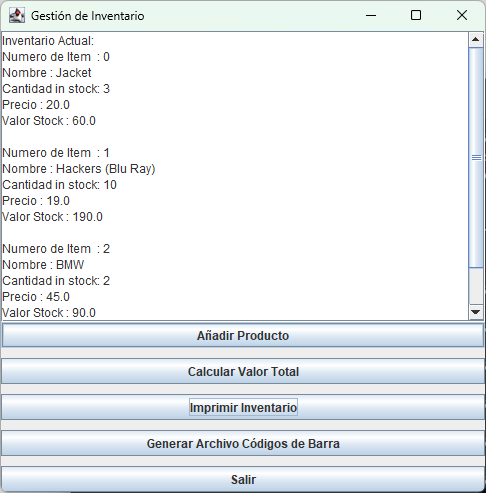

# Inventario con código de barras (Java)

Inventario sencillo en Java con manejo de stock por **código de barras**: buscar un producto escaneando su
código (con un lector USB o con el teléfono como lector), registrar entradas y salidas, y generar e imprimir
códigos **Code 128** sin instalar fuentes.

Nace del proyecto final de *Java Fundamentals* ([xcero/Fundamentals](https://github.com/xcero/Fundamentals));
la historia de git de ese proyecto se conserva aquí. El README original está en
[docs/README-Fundamentals.md](docs/README-Fundamentals.md).



## Requisitos

- JDK 21 (por ejemplo Microsoft Build of OpenJDK).
- VS Code con el **Extension Pack for Java**.

No usa Maven ni Gradle: es Java puro, para aprender cómo funcionan los packages, `javac` y el classpath.

## Ejecutar

En VS Code: **Run and Debug** (Ctrl+Shift+D) → *Inventario (consola)*, *Inventario (ventana)* o
*Ver código de barras*.

En la terminal:

```powershell
javac -encoding UTF-8 -d bin (Get-ChildItem -Recurse -Filter *.java -Path src, pruebas).FullName
java -cp bin io.github.xcero.inventario.app.InventoryTest
```

## Estructura

```
src/io/github/xcero/inventario/
├── modelo/        Product, CD, DVD
├── servicio/      Inventory
├── codigobarras/  Code128, Code128Patrones, PanelCodigoBarras, Ean13
└── app/           InventoryTest (consola), InventoryTestGUI, VentanaCodigoBarras
pruebas/           Verificar: revisa los ejercicios del lab
```

## Lab

Los ejercicios para mejorar el proyecto están en [LAB.md](LAB.md). Para ver cómo vas:
**Terminal → Run Task… → Verificar ejercicios**.
